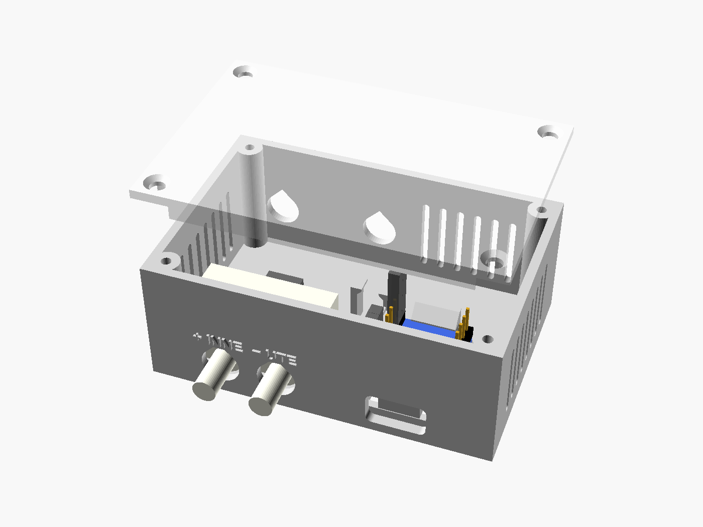
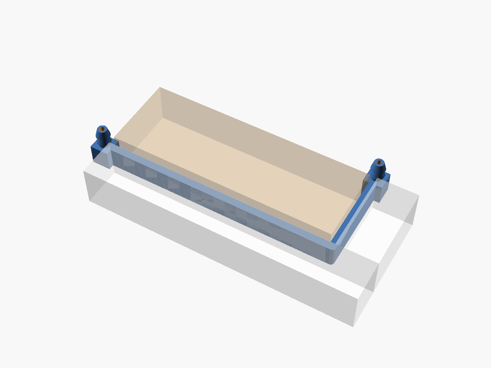

# Enclosure

A two-part 3D-printable box for the SDP810 + ESP32-C3-Zero sensor. There is no breadboard: the base is
the carrier and both boards mount directly to it. The box is 76 × 51 × 31 mm and has no wall
mount; stick it up with double-sided foam tape if you want it on a wall. The SDP810 ports and the USB-C cable come out of the bottom.



| File | What |
|---|---|
| [`house-pressure-enclosure.scad`](house-pressure-enclosure.scad) | Parametric model. All dimensions are named parameters at the top. Physical part dimensions are tagged `MEASURE`. |
| `stl/base.stl` | Base / carrier, oriented for printing (back plate down) |
| `stl/lid.stl` | Lid, oriented for printing (outer face down) |
| `stl/coupon.stl` | Test-fit coupon: C3 cradle, USB-C cutout, SDP810 wall with port holes, bosses and labels |
| [`window-feedthrough.scad`](window-feedthrough.scad), `stl/window-feedthrough.stl` | Flat L-shaped part that takes the outdoor air path through the closed window (see below) |
| `png/*.png` | Preview renders |
| [`build.sh`](build.sh) | Re-exports all STLs and PNGs and runs the manifold check |
| [`check_manifold.py`](check_manifold.py) | Checks that every edge is shared by exactly two consistently oriented triangles |

```bash
./build.sh                                  # lid screwed on with 4 small wood screws (default)
```

```bash
./build.sh -D 'lid_fastening="snap"'        # snap-fit lid instead (box is 6 mm narrower)
```

You can also open the `.scad` file in OpenSCAD and use the Customizer. Set `part` to `base`, `lid`,
`coupon` or `assembly`.

## Layout

Seen from the front, with the box on the wall:

- **SDP810**, bottom left. It is screwed to two bosses on the inside of the bottom wall, and its ports go
  down through the wall. The port holes are sized for the 8 mm tube (`sdp_tube_od`), so the tube slides
  through the wall onto the barb. "High" is on the left and is marked **+ INNE**. "Low" is marked **− UTE**.
  The labels are raised on the underside, above each port. There is 15 mm of free space behind the pins
  for the 2.0 mm header and its wires. Two holes in the top wall line up with the screws, so a long
  screwdriver can reach them.
- **ESP32-C3-Zero-M**, bottom right. It sits upside down: components face the wall and the header pins point
  at the lid. The USB-C edge is against the bottom wall cutout, which is sized for a normal 13 × 7.5 mm plug
  body. The PCB rests on two 0.5 mm edge ledges. Two hooks on the bottom wall hold the ends of the header
  spacers at the USB end. One thin snap holds the antenna end. There is no plastic under the antenna.
  A window in the back plate under the board lets you press BOOT / RESET and see the LED (`back_window`).
- **Wire clip** between the two boards.
- **Vents** in the left wall (the "+" side), the right wall and the top wall. The "+" barb is open to room air.

## Print settings

| Setting | Value |
|---|---|
| Material | PLA or PETG |
| Nozzle / layer | 0.4 mm / 0.2 mm |
| Perimeters | 3 (the bosses, snaps and hooks are thin, so they should be solid perimeters) |
| Infill | 20 % |
| Supports | **None**. Horizontal holes are teardrops, the bosses have a 45° underside. |
| Orientation | As exported: base on its back plate, lid on its outer face, coupon on its back plate |

PETG holds threads better but shrinks less. For PETG, set `sdp_pilot_d = 2.2` and `lid_pilot_d = 2.4`.

## Hardware

| Qty | Part |
|---|---|
| 2 | M2.5 × 14 screws, self-tapping into the plastic (SDP810). This assumes the ear holes run through the full 10.25 mm body. If your ears are thinner, use screws that are 3–4 mm longer than the ear. |
| 4 | Small countersunk wood screws for the lid, 2.5 × 10–12 mm (head about 5 mm). For other sizes set `lid_pilot_d`, `lid_clear_d`, `lid_head_d` and `lid_screw_depth`. |
| 1 | 4-pin 2.0 mm female header with wires (SDP810 side) |
| 4 | Female Dupont connectors (C3 side) |
| 2 | 4.7 kΩ resistors (I²C pull-ups, see below) |

## Assembly order

1. **Print the coupon first** and test both boards in it (see "If it doesn't fit").
2. **Make the harness.** Solder the four wires to the 2.0 mm header. Without a breadboard, put the two
   4.7 kΩ pull-ups at the header end: one from SDA to VDD and one from SCL to VDD. Cover them with heat-shrink.
   Crimp Dupont housings on the other end.
3. **Mount the SDP810.** Push the barbs out through the bottom wall from the inside, with "High" on the left.
   Put the M2.5 screws through the ears and drive them through the access holes in the top wall.
   Tighten until snug. Don't overtighten, or you'll strip the plastic.
4. **Push the 2.0 mm header** onto the SDP810 pins.
5. **Insert the C3-Zero** upside down. Tilt it, slide the USB end against the bottom wall so the ends of the
   header spacers go under the two hooks, then press the antenna end down until the snap clicks.
6. **Plug in the Duponts.** Use the pin row facing the SDP810. Pin 1 (5V) is the one nearest the USB-C
   connector. Counting from there:
   pin 2 = **GND**, pin 3 = **3V3**, pin 8 = **GPIO4 (SDA)**, pin 9 = **GPIO5 (SCL)**.
   See the wiring table in the [main README](../README.md#wiring).
7. **Route the wires** through the clip, plug in USB and check that the sensor reports values.
8. **Close the lid** with the four wood screws in the corners. Stop as soon as the heads are flush, or
   they strip the plastic. (Snap lid: press until both long sides click; lever it up at the notch in the right wall to open.)
9. **Fit the tube.** The port holes are big enough for an 8 mm tube. Push the outdoor tube onto the
   **− UTE** barb and on through the hole until it stops at the port flange inside, so it grips the whole
   barb. Leave **+ INNE** open.

## If it doesn't fit

Change the parameter, then run `./build.sh` again. Print the coupon again before you print the full box.

| Symptom | Parameter(s) |
|---|---|
| C3 PCB too tight or too loose between the rails | `c3_w_play` (default 4.5 mm, split between both sides), `c3_w`, `clr` |
| C3 won't go under the USB-end hooks, or rattles under them | `c3_hdr_h` (measure the header spacer), `c3_t` |
| Antenna-end snap won't click, or the board lifts | `snap_hook` (0.5–1.0), `snap_t` (thinner = softer) |
| C3 cradle too short: the board won't drop in past the snap | `c3_l_play` (default 2.0 mm; raise in 0.2 mm steps) |
| Ledge hits the solder stubs on the component side | `c3_ledge` (smaller) |
| USB-C plug doesn't reach the receptacle | `usb_plug_w`, `usb_plug_h` (measure your cable), `c3_usb_overhang`, `c3_usb_dx` |
| USB-C plug body hits the wall behind the box | `usb_center_z` (higher) |
| SDP810 barbs don't line up with the holes | `sdp_port_dx`, `sdp_port_off`, `sdp_hole_dx` |
| Tube doesn't go through the port holes | `sdp_tube_od` (your tube's outside diameter), `clr` |
| Tube doesn't reach far enough onto the barb | `sdp_boss_h` (lower, but at least `sdp_flange_z` + 0.4) |
| Port flange touches the wall | `sdp_boss_h` (higher; must be at least `sdp_flange_z` + 0.4) |
| "High" / "Low" labels are on the wrong ports | `sdp_high_left = false` |
| M2.5 screws strip or crack the bosses | `sdp_pilot_d` (2.1 for PLA, 2.2 for PETG) |
| Dupont wires press against the lid | `dupont_h`, `wire_bend` |
| Lid screws strip, or are too hard to drive / split the corner bosses | `lid_pilot_d` (larger = easier), `lid_screw_depth` |
| Lid screw heads stick out, or sink through | `lid_head_d` (0 = no countersink), `lid_clear_d` |
| Lid snap too hard or too soft | `snap_bump` (0.6–1.0), `snap_len` |

## Assumed dimensions (check with calipers)

The SDP810 dimensions come from Figures 2 and 3 of the Sensirion SDP8xx-Digital datasheet (v1.1). The
C3-Zero dimensions come from Waveshare's drawing. These values were **not** in either drawing, so the model
uses typical values:

- `c3_t` = 1.0 mm PCB thickness
- `c3_hdr_h` = 2.5 mm header spacer height, and `c3_pin_len` = 6 mm
- `c3_usb_h` = 3.2 mm, `c3_usb_overhang` = 0 (the receptacle ends flush with the PCB edge)
- The SDP810 body is centred on the ear-hole line, and the ear holes run through the full body height.
- "High" is on the left when you look at the port face with the ear-hole line above the ports.
  The datasheet's port-side view shows it this way. Check the marking on your sensor.

## Window feedthrough

A soft tube in a closed window gets pinched shut by the gasket. This part goes through the gap instead.
It is a thin, rigid, L-shaped blade with an air channel inside, and it bends around the L-shaped ledge
between the sash and the frame. Each end has a hose barb, outside the gap. The gasket presses on the flat
blade, not on the tube.



With the default 3.0 mm gap, the blade is 2.7 mm thick and 8 mm wide, with a 1.1 × 6.4 mm channel inside.
The legs are 85 mm (room side) and 30 mm (outside), and the whole part is about 96 × 41 mm.

### Measure your window

1. Put a strip of Blu-Tack or modelling clay across the gap at the spot you want to use, close the
   window, then open it again.
2. **`gap`:** the thickness of the squeezed strip. The blade is printed `fit` (0.3 mm) thinner, so the
   window still latches. The smallest gap that works is about 2.5 mm; below that the channel gets too small.
3. **`leg_in`:** the length of the squeezed strip from the room-side edge to the ledge corner.
   **`leg_out`:** from the corner to the outside edge. ±1 mm is fine, because the hubs sit outside the gap.
4. **Tube:** the barbs copy the SDP810 ports (`barb_d` 5.2 mm, `barb_tip` 3.5 mm), so the tube that fits
   the sensor fits here too. A 4 × 8 mm silicone tube works well. For a thinner tube, lower both values.
5. If the L turns the other way at your window, set `mirror_l = true`.

```bash
openscad -o enclosure/stl/window-feedthrough.stl -D gap=3.2 -D leg_in=34 -D leg_out=18 enclosure/window-feedthrough.scad
```

### Print and fit

- **PETG, 100 % infill, 0.2 mm layers or finer**, printed lying flat as exported (barbs up). No supports.
- **Test it for leaks before fitting.** Put a tube on one barb, close the other barb with your finger,
  hold the part under water and blow gently. If you see bubbles, print it again with 3 perimeters
  (`skin = 1.2`, which needs about a 3.3 mm gap), or brush thin epoxy or nail polish over the outside.
  A leak mixes indoor air into the outdoor reading and pulls the value toward 0 Pa.
- Put it on the **hinge side** of the window, where the gasket is pressed evenly. Don't put it near the handle.
- The barbs point along the window edge. On a vertical edge, turn the part so the outside barb points
  **down**, and put a short tube on it pointing down too. Then rain and condensation run out instead of
  sitting in the channel or freezing.
- Run the room-side barb to the **− UTE** port with as short a tube as you can. The narrow channel adds
  roughly as much flow resistance as 90 cm of tube. That doesn't matter at these pressures as long as
  the total stays under about 1.5 m.
